# ブレンドシェイプ図鑑（VisageBlendShape Tips）

VRChat・ARKit 52・Unified Expressions・MMD・VRM で使う表情キー（ブレンドシェイプ／シェイプキー）が、**顔のどこを、どう動かすキーなのか** を絵でまとめたページです。

**▶ 一覧ページ（GitHub Pages・規格で絞り込み／検索）: https://gyogy6.github.io/Sayu_VisageBlendShapeTips_WebPages/**

## 見かた

- **Before**（下の図）はすべてのキーが 0 の状態（ベース）です。**After** の図は、そのキーを 1 にした状態です。
- 動きがほとんど同じキーは、規格が違っても **1 枚の After 図にまとめています**。表の 1 行が 1 つの動き（親）で、各列がその動きをする各規格のキー（子）です。
- 記号: 何もなし＝同じ動き ／ `≈` ＝近い動き（違いは説明に書いています）／ `＋` ＝その規格では複数のキーを組み合わせて作る
- 図の **右側がキャラの左** です（キャラが正面を向いているため）。ARKit などの `...Left` は **キャラの左** の意味です。`Left / Right` が対になるキーは Left の動きを描いています。Right はその鏡写しです。
- オレンジの点線の丸が動く場所、青の点線が動かす前の位置、オレンジの矢印が動く向きと量です。下の 2 枚は動く場所の拡大（前・後）です。
- 右上の「横（断面）」は頭を縦に切った図で、前後の動き（唇を突き出す、あごを前に出す、舌など）を見るためのものです。右下の「口の中」は唇を外して、歯と舌が見えるようにした図です。

## Before（すべてのキーが 0）

- 口は閉じて、目は開いています。VRChat の `vrc.v_sil`（無音）と VRM の `neutral` はこの形です（動かないキー）。
- 横の図の **青い線** は、特殊表情用の **隠しパーツ** です。ハートの目・頬の赤み・涙・縦線などは、ふだん顔の表面より奥（頭の中）に置いて見えないようにしておき、キーを 1 にしたときに表面の手前まで動かして見せます。
- 舌のキーは、口を閉じたままでも動きます（外からは見えません）。舌だけが動くキーは「口の中」の図で見てください。

## 目次

- [目（まぶた）](#eye)（9）
- [視線・瞳](#gaze)（9）
- [眉](#brow)（7）
- [あご](#jaw)（3）
- [口（ビセーム・あいうえお）](#viseme)（14）
- [口（ARKit・UE の部品キー）](#mouth)（14）
- [口（MMD の形）](#mmdmouth)（6）
- [頬・鼻](#cheek)（3）
- [舌（舌だけが動く）](#tongue)（10）
- [表情セット（VRM プリセット）](#combo)（5）
- [特殊表情（隠しパーツ）](#special)（8）
- [規格ごとのキー名から探す](#index)

## 目（まぶた）

| After（1 のとき） | 動き（親） | VRChat | ARKit | UE | MMD | VRM |
|---|---|---|---|---|---|---|
| 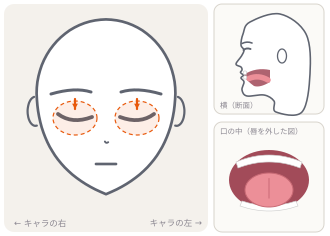 | **両目を閉じる** 上まぶたが下りて、下まぶたと合わさります。まつげやアイラインのパーツも一緒に動かします。 | `vrc.blink` | ＋ `eyeBlinkLeft + eyeBlinkRight` | `EyeClosed` ＋ `EyeClosedLeft + EyeClosedRight` | `まばたき` | `blink` |
| 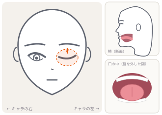 | **片目を閉じる（左）** 片方の目だけを閉じます。右はこの鏡写しです。MMD の「ウィンク２」は、まぶたをまっすぐ閉じるウィンクです。 | — | `eyeBlinkLeft` `eyeBlinkRight` | `EyeClosedLeft` `EyeClosedRight` | `ウィンク２` `ｳｨﾝｸ２右` | `blinkLeft` `blinkRight` |
| 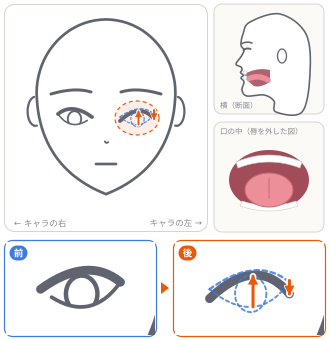 | **笑顔のウィンク（左）** 目を ^ の形に閉じます（下まぶたが上がる）。右はこの鏡写しです。 | — | ＋ `eyeBlinkLeft + eyeSquintLeft + cheekSquintLeft` | — | `ウィンク` `ウィンク右` | — |
|  | **笑い目（^ ^）** 両目を ^ の形に閉じます。口は動きません（口まで笑うのは VRM の happy）。 | — | ＋ `eyeBlink + eyeSquint + cheekSquint（両側）` | — | `笑い` | — |
| 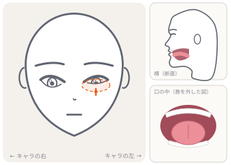 | **目を細める（左）** 下まぶたが上がって、目が細くなります。上まぶたはほとんど動きません。 | — | `eyeSquintLeft` `eyeSquintRight` | `EyeSquintLeft` `EyeSquintRight` `EyeSquint` | — | — |
| 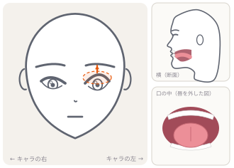 | **目を見開く（左）** 上まぶたが上がり、黒目の上に白目が見えます。MMD の「びっくり」は両目の見開きに、瞳を小さくするのを足したものです。 | — | `eyeWideLeft` `eyeWideRight` | `EyeWideLeft` `EyeWideRight` `EyeWide` | ≈ `びっくり` | — |
| 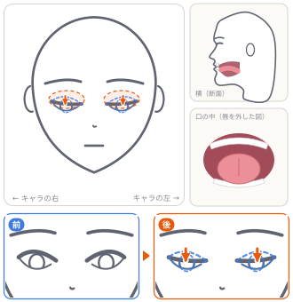 | **じと目** 上まぶたが半分まで、まっすぐ下ります。 | — | ＋ `eyeBlink 0.5 くらい（両側）` | — | `じと目` | — |
|  | **なごみ** 上まぶたが下がり、目じりも下がった、やわらかい目です。 | — | — | — | `なごみ` | ≈ `relaxed` |
| 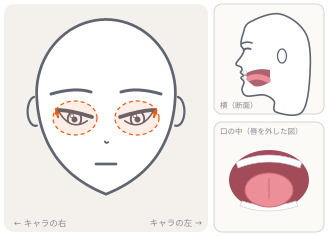 | **キリッ** 目じりが上がり、上まぶたが少し下りて、鋭い目になります。 | — | — | — | `ｷﾘｯ` | — |

## 視線・瞳

| After（1 のとき） | 動き（親） | VRChat | ARKit | UE | MMD | VRM |
|---|---|---|---|---|---|---|
| 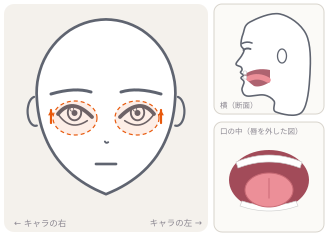 | **上を見る** 黒目が上へ動き、上まぶたも少し上がります。VRChat の Looking Up は、目のボーンで視線を動かすときに合わせて使う『まぶたの形』です。 | ≈ `vrc.looking_up` | ＋ `eyeLookUpLeft + eyeLookUpRight` | ＋ `EyeLookUpLeft + EyeLookUpRight` | ≈ `（なし）` | `lookUp` |
| 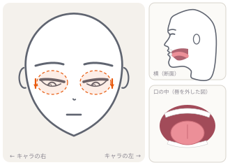 | **下を見る** 黒目が下へ動き、上まぶたも一緒に下ります。 | ≈ `vrc.looking_down` | ＋ `eyeLookDownLeft + eyeLookDownRight` | ＋ `EyeLookDownLeft + EyeLookDownRight` | — | `lookDown` |
| 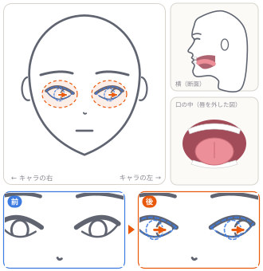 | **キャラの左を見る（両目）** 両目の黒目がキャラの左（図の右）へ動きます。左目は外側、右目は内側（鼻の方）へ動くので、ARKit では Out と In の組み合わせです。 | — | ＋ `eyeLookOutLeft + eyeLookInRight` | ＋ `EyeLookOutLeft + EyeLookInRight` | — | `lookLeft` |
| 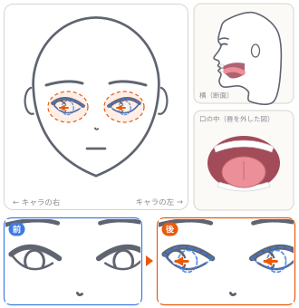 | **キャラの右を見る（両目）** 両目の黒目がキャラの右（図の左）へ動きます。 | — | ＋ `eyeLookInLeft + eyeLookOutRight` | ＋ `EyeLookInLeft + EyeLookOutRight` | — | `lookRight` |
|  | **左目だけ外を見る** 左目の黒目だけが外側（耳の方）へ動きます。右目の eyeLookOutRight は鏡写しです。 | — | `eyeLookOutLeft` `eyeLookOutRight` | `EyeLookOutLeft` `EyeLookOutRight` | — | — |
| 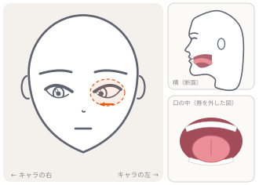 | **左目だけ内を見る** 左目の黒目だけが内側（鼻の方）へ動きます。右目の eyeLookInRight は鏡写しです。 | — | `eyeLookInLeft` `eyeLookInRight` | `EyeLookInLeft` `EyeLookInRight` | — | — |
| 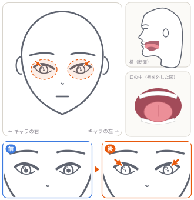 | **瞳を小さく** 黒目（瞳）を縮めます。白目のまわりは動きません。 | — | — | `EyeConstrictLeft / EyeConstrictRight` `EyeConstrict` | `瞳小` | — |
|  | **瞳を大きく** 黒目（瞳）を広げます。 | — | — | `EyeDilationLeft / EyeDilationRight` `EyeDilation` | `瞳大` | — |
| 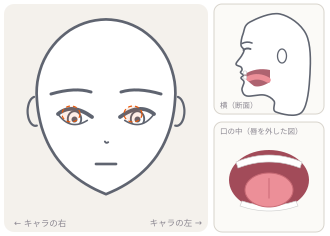 | **ハイライトを消す** 目のハイライト（白い点）のパーツを小さくして、瞳の奥へ隠します。メッシュでなくマテリアルで消すモデルもあります。 | — | — | — | `ハイライト消し` | — |

## 眉

| After（1 のとき） | 動き（親） | VRChat | ARKit | UE | MMD | VRM |
|---|---|---|---|---|---|---|
| 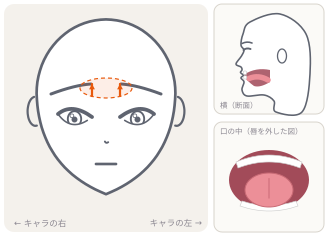 | **眉の内側を上げる** 眉の内側（眉間側）が上がり、困ったような眉になります。MMD の「困る」は、外側を少し下げたものです。 | — | `browInnerUp` | `BrowInnerUp` ＋ `BrowInnerUpLeft + BrowInnerUpRight` | ≈ `困る` | — |
| 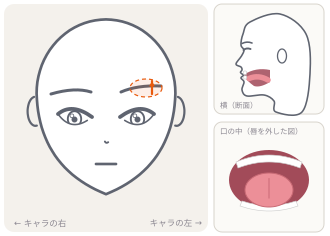 | **眉の外側を上げる（左）** 左の眉の外側（目じり側）だけが上がります。 | — | `browOuterUpLeft` `browOuterUpRight` | `BrowOuterUpLeft` `BrowOuterUpRight` | — | — |
| 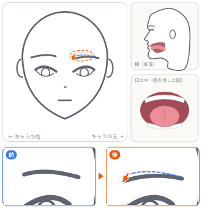 | **眉を下げて寄せる（左）** 左の眉が下がり、内側が眉間に寄ります。両方を使うと怒った眉になります。 | — | `browDownLeft` `browDownRight` | `BrowDownLeft` `BrowDownRight` ＋ `BrowLowererLeft + BrowPinchLeft` | ≈ `怒り（両方）` | — |
| 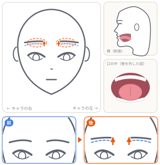 | **眉全体を上げる** 眉全体が上へ動きます。 | — | ＋ `browInnerUp + browOuterUpLeft + browOuterUpRight` | `BrowUp` | `上` | — |
|  | **眉全体を下げる（まっすぐ）** 眉全体が下がり、まっすぐに近くなります。「真面目」は下げる量が少し小さいものです。 | — | — | — | `下` ≈ `真面目` | — |
| 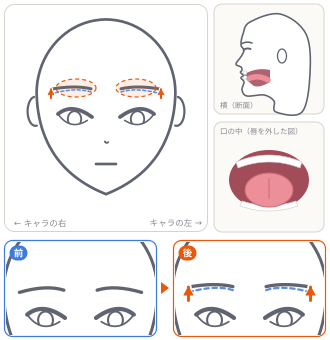 | **にこり（眉）** 眉が上がって、外側が下がり気味のやわらかい弧になります。 | — | — | — | `にこり` | — |
| 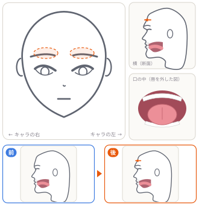 | **眉を前へ出す** 眉が顔の前（手前）へ出ます。正面からはほとんど変わらないので、横の図を見てください。 | — | — | — | `前` | — |

## あご

| After（1 のとき） | 動き（親） | VRChat | ARKit | UE | MMD | VRM |
|---|---|---|---|---|---|---|
| 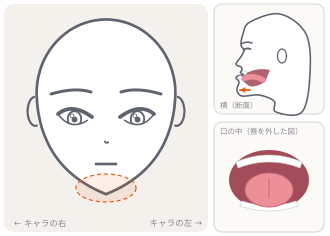 | **あごを前へ出す** 下あごが前へ出ます。正面からはほとんど変わりません。 | — | `jawForward` | `JawForward` | — | — |
| 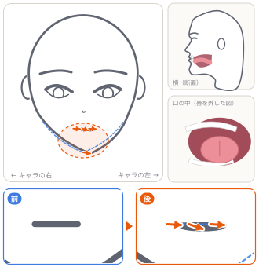 | **あごを左へ** 下あごがキャラの左（図の右）へずれます。口も一緒に動きます。 | — | `jawLeft` `jawRight` | `JawLeft` `JawRight` | — | — |
| 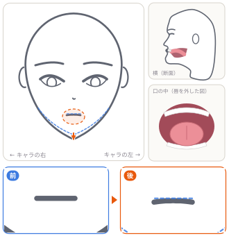 | **あごを開けたまま唇を閉じる** jawOpen と一緒に使うキーで、開いたあごのまま唇だけを閉じます（図は jawOpen 0.5 と一緒）。単独で 1 にすると唇が顔にめりこむことがあります。 | — | `mouthClose` | `MouthClosed` | — | — |

## 口（ビセーム・あいうえお）

| After（1 のとき） | 動き（親） | VRChat | ARKit | UE | MMD | VRM |
|---|---|---|---|---|---|---|
| 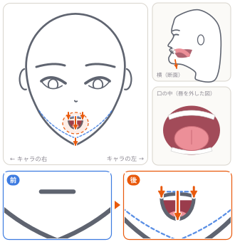 | **あ（口を大きく開ける）** あごが下がって口が大きく開きます。ARKit・UE の jawOpen はあごだけのキーなので、唇の形は他のキーと合わせて作ります。 | `vrc.v_aa` | ≈ `jawOpen` | ≈ `JawOpen` ≈ `MouthOpen` | `あ` | `aa` |
|  | **い** 口が横に広がって、少しだけ開きます。 | `vrc.v_ih` | ＋ `jawOpen + mouthStretch + mouthSmile` | — | `い` | `ih` |
|  | **う** 唇をすぼめて前へ出し、少しだけ開きます。 | `vrc.v_ou` | ＋ `mouthPucker + mouthFunnel` | — | `う` | `ou` |
| 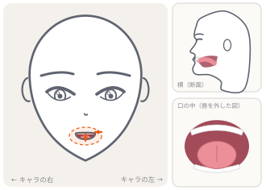 | **え** 口が横に広がって、「い」より大きく開きます。 | `vrc.v_e` | ＋ `jawOpen + mouthStretch` | — | `え` | `ee` |
| 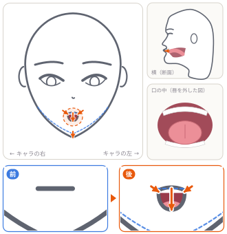 | **お** 口が丸く縦に開き、唇が少し前へ出ます。 | `vrc.v_oh` | ＋ `jawOpen + mouthFunnel` | — | `お` | `oh` |
|  | **P・B・M（唇を閉じて押す）** 唇を閉じて、上下から押し合わせます。MMD の「ん」もほぼ同じ形です。 | `vrc.v_pp` | ＋ `mouthPressLeft + mouthPressRight + mouthRoll` | — | ≈ `ん` | — |
|  | **F・V（下唇を上の歯に当てる）** 下唇を内側へ巻きこんで、上の歯に当てます。上唇は少し上がります。 | `vrc.v_ff` | ＋ `mouthRollLower + mouthUpperUp` | — | — | — |
| 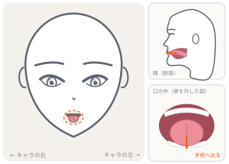 | **TH（舌先を歯の間に）** 口を少し開けて、舌の先を上下の歯の間から少し出します。 | `vrc.v_th` | ＋ `jawOpen + tongueOut` | — | — | — |
| 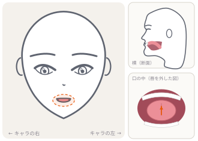 | **D・T（少し開いて横へ）** 口が少し開いて、少し横に広がります。舌先は上の歯の裏に付きます。 | `vrc.v_dd` | ＋ `jawOpen + mouthStretch` | — | — | — |
|  | **K・G（少し開く）** 口が少し開きます。舌の奥が上がります（口の中なので外からはほとんど見えません）。 | `vrc.v_kk` | ＋ `jawOpen + mouthStretch` | — | — | — |
| 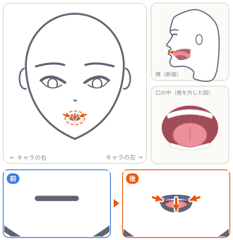 | **CH・J・SH（唇を突き出して開く）** 唇を前へ突き出して、四角っぽく少し開きます。 | `vrc.v_ch` | ＋ `jawOpen + mouthFunnel + mouthPucker` | — | — | — |
|  | **S・Z（歯を合わせて横へ）** 歯を合わせたまま、唇を横に引きます。 | `vrc.v_ss` | ＋ `mouthStretch + mouthSmile` | — | — | — |
| 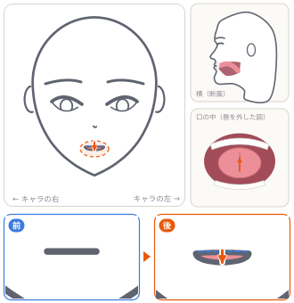 | **N・L（少し開く）** 口を少し開けます。舌先は上の歯の裏に付きます。 | `vrc.v_nn` | ＋ `jawOpen + mouthStretch` | — | — | — |
|  | **R（少しすぼめる）** 口を少し開けて、唇を少しすぼめます。 | `vrc.v_rr` | ＋ `jawOpen + mouthPucker` | — | — | — |

## 口（ARKit・UE の部品キー）

| After（1 のとき） | 動き（親） | VRChat | ARKit | UE | MMD | VRM |
|---|---|---|---|---|---|---|
| 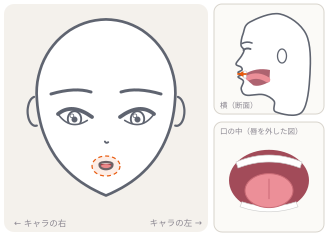 | **唇を丸く突き出して開く（ラッパ形）** 唇を前へ出して、丸く開きます。 | — | `mouthFunnel` | `LipFunnel` ＋ `LipFunnelUpper/Lower Left/Right（4 つ）` | — | — |
|  | **唇をすぼめる（キス）** 唇を閉じたまま、小さくすぼめて前へ出します。 | — | `mouthPucker` | `LipPucker` ＋ `LipPuckerUpper/Lower Left/Right（4 つ）` | — | — |
| 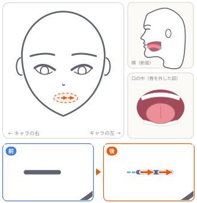 | **口を左へ寄せる** 閉じた口が、あごは動かさずにキャラの左（図の右）へずれます。 | — | `mouthLeft` `mouthRight` | `MouthLeft` ＋ `MouthUpperLeft + MouthLowerLeft` | — | — |
| 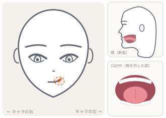 | **口角を上げる（左）** 左の口角が上と横へ引かれます。両方を使うと MMD の「口角上げ」になります。 | — | `mouthSmileLeft` `mouthSmileRight` | `MouthSmileLeft` `MouthSmileRight` ＋ `MouthCornerPullLeft (+ MouthCornerSlantLeft)` | ≈ `口角上げ（両方）` | — |
| 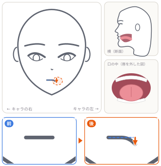 | **口角を下げる（左）** 左の口角が下へ引かれます。両方を使うと MMD の「口角下げ」になります。 | — | `mouthFrownLeft` `mouthFrownRight` | `MouthFrownLeft` `MouthFrownRight` ≈ `MouthSadLeft` | ≈ `口角下げ（両方）` | — |
| 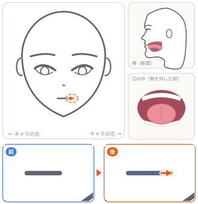 | **口を横へ引く（左）** 左の口角が真横（少し下）へ引かれます。両方を使うと MMD の「口横広げ」になります。 | — | `mouthStretchLeft` `mouthStretchRight` | `MouthStretchLeft` `MouthStretchRight` | ≈ `口横広げ（両方）` | — |
| 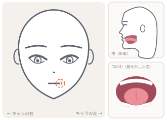 | **えくぼ（左）** 左の口角が後ろ（頬の奥）へ引かれて、少し横に広がります。 | — | `mouthDimpleLeft` `mouthDimpleRight` | `MouthDimpleLeft` `MouthDimpleRight` | — | — |
| 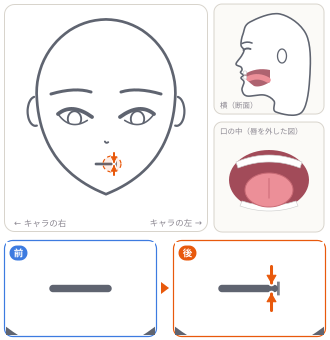 | **唇を押しつける（左）** 閉じた唇の左側を、上下からぎゅっと押し合わせます。 | — | `mouthPressLeft` `mouthPressRight` | `MouthPressLeft` `MouthPressRight` | — | — |
|  | **下唇を下げる（左）** 左側の下唇だけが下へ下がり、下の歯が見えます。 | — | `mouthLowerDownLeft` `mouthLowerDownRight` | `MouthLowerDownLeft` `MouthLowerDownRight` | — | — |
|  | **上唇を上げる（左）** 左側の上唇だけが上へ上がり、上の歯が見えます。 | — | `mouthUpperUpLeft` `mouthUpperUpRight` | `MouthUpperUpLeft` `MouthUpperUpRight` | — | — |
| 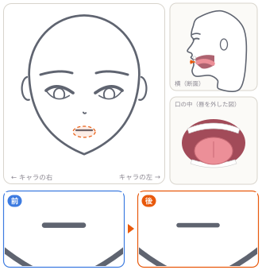 | **下唇を内へ巻きこむ** 下唇を歯の内側へ巻きこみます。正面からは唇が細く見えるだけなので、横の図を見てください。 | — | `mouthRollLower` | `LipSuckLower` ＋ `LipSuckLowerLeft + LipSuckLowerRight` | — | — |
| 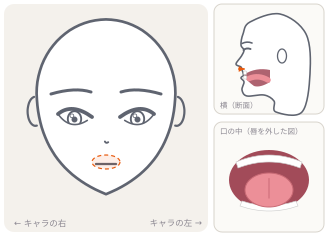 | **上唇を内へ巻きこむ** 上唇を歯の内側へ巻きこみます。 | — | `mouthRollUpper` | `LipSuckUpper` ＋ `LipSuckUpperLeft + LipSuckUpperRight` | — | — |
|  | **下唇を押し上げる** あご先の筋肉で下唇を押し上げます。への字口や、すねた口に使います。 | — | `mouthShrugLower` | `MouthRaiserLower` | — | — |
|  | **上唇を押し上げる** 上唇が上へ押し上げられます。 | — | `mouthShrugUpper` | `MouthRaiserUpper` | — | — |

## 口（MMD の形）

| After（1 のとき） | 動き（親） | VRChat | ARKit | UE | MMD | VRM |
|---|---|---|---|---|---|---|
| 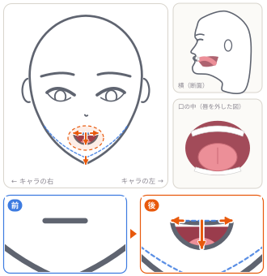 | **ワ** 大きく開けて、口角を上げた笑い口です。 | — | ＋ `jawOpen + mouthStretch + mouthSmile` | — | `ワ` | — |
|  | **▲** 三角形に開けた口です。 | — | ＋ `jawOpen + mouthFunnel + mouthFrown` | — | `▲` | — |
|  | **∧** 閉じた口を ∧ の形（への字）にします。 | — | ＋ `mouthFrown + mouthShrugLower` | — | `∧` | — |
| 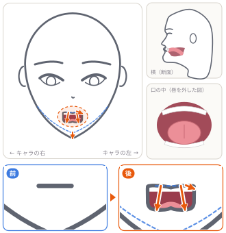 | **□** 四角く大きく開けた口です（叫ぶとき）。 | — | ＋ `jawOpen + mouthStretch + mouthUpperUp + mouthLowerDown` | — | `□` | — |
|  | **ω** 閉じた口を ω の形にします（ねこ口）。 | — | ＋ `mouthSmile + mouthShrugUpper` | — | `ω` | — |
| 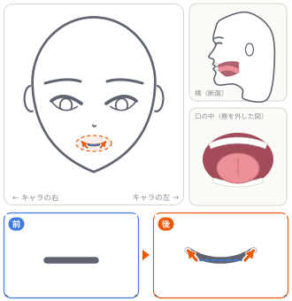 | **にやり** 閉じたまま、口角を強く上げて横へ引きます。 | — | ＋ `mouthSmile + mouthStretch（両側）` | — | `にやり` | — |

## 頬・鼻

| After（1 のとき） | 動き（親） | VRChat | ARKit | UE | MMD | VRM |
|---|---|---|---|---|---|---|
|  | **頬をふくらませる** 頬が横と前へふくらみます。 | — | `cheekPuff` | `CheekPuff` ＋ `CheekPuffLeft + CheekPuffRight` | — | — |
| 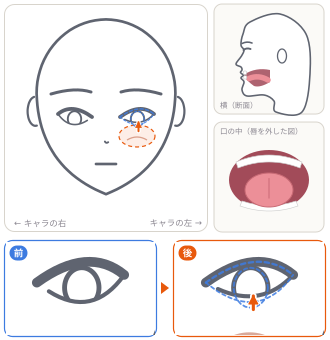 | **頬を上げる（左）** 左の頬が上がって、下まぶたを押し上げます。笑ったときの頬です。 | — | `cheekSquintLeft` `cheekSquintRight` | `CheekSquintLeft` `CheekSquintRight` `CheekSquint` | — | — |
| 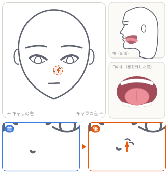 | **鼻にしわを寄せる（左）** 鼻の左わきが上がって、しわができます。上唇も少し上がります。 | — | `noseSneerLeft` `noseSneerRight` | `NoseSneerLeft` `NoseSneerRight` | — | — |

## 舌（舌だけが動く）

| After（1 のとき） | 動き（親） | VRChat | ARKit | UE | MMD | VRM |
|---|---|---|---|---|---|---|
| 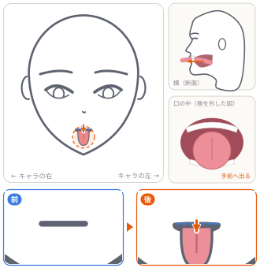 | **舌を出す** 舌が口の外へ出ます。ARKit で舌のキーはこれだけです。MMD の「ぺろっ」は口を少し開けて舌を少し出したものです。 | — | `tongueOut` | `TongueOut` | ≈ `ぺろっ` | — |
| 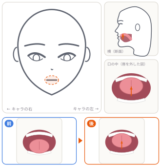 | **舌先を上げる** 舌の先が上（上の歯の裏）へ上がります。口の外からは見えません。 | — | — | `TongueUp` | — | — |
| 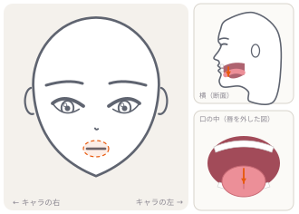 | **舌先を下げる** 舌の先が下（下の歯の裏）へ下がります。 | — | — | `TongueDown` | — | — |
| 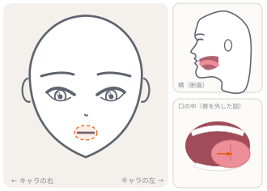 | **舌を左へ** 舌がキャラの左（図の右）へ動きます。右はこの鏡写しです。 | — | — | `TongueLeft` `TongueRight` | — | — |
|  | **舌を丸める（筒形）** 舌の左右のふちを上げて、筒のように丸めます。 | — | — | `TongueRoll` | — | — |
| 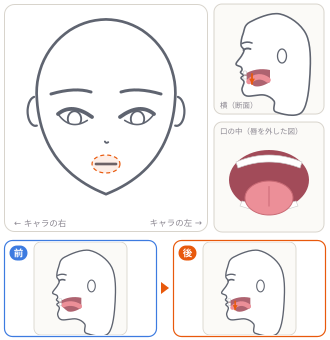 | **舌を下へ曲げる** 舌の先を下へ曲げます（舌の背が盛り上がる）。 | — | — | `TongueBendDown` | — | — |
| 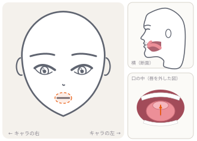 | **舌先を上へ反らす** 舌の先を上へ反らして、裏側が見えるようにします。 | — | — | `TongueCurlUp` | — | — |
|  | **舌を縮める（太く短く）** 舌を前後に縮めて、太く短くします。 | — | — | `TongueSquish` | — | — |
|  | **舌を平らに広げる** 舌を薄く、横に広げます。 | — | — | `TongueFlat` | — | — |
|  | **舌をねじる（左）** 舌を前後の軸のまわりにねじります。右はこの鏡写しです。 | — | — | `TongueTwistLeft` `TongueTwistRight` | — | — |

## 表情セット（VRM プリセット）

| After（1 のとき） | 動き（親） | VRChat | ARKit | UE | MMD | VRM |
|---|---|---|---|---|---|---|
|  | **喜び（happy）** 目を ^ の形にして、口角を上げます。 | — | ＋ `eyeBlink + eyeSquint + cheekSquint + mouthSmile` | — | ＋ `笑い + 口角上げ` | `happy` |
|  | **怒り（angry）** 眉を下げて寄せ、目を細め、口角を下げます。 | — | ＋ `browDown + eyeSquint + mouthFrown` | — | ＋ `怒り + ｷﾘｯ + 口角下げ` | `angry` |
|  | **悲しみ（sad）** 眉の内側を上げ、上まぶたを少し下ろし、口角を下げます。 | — | ＋ `browInnerUp + eyeBlink + mouthFrown` | — | ＋ `困る + 口角下げ` | `sad` |
|  | **安らぎ（relaxed）** 目をやわらかく細め、口角を少し上げます。 | — | — | — | ＋ `なごみ + 口角上げ` | `relaxed` |
|  | **驚き（surprised）** 目を見開いて眉を上げ、口を開けます。MMD の「びっくり」は目だけです。 | — | ＋ `eyeWide + browInnerUp + browOuterUp + jawOpen` | — | ＋ `びっくり + 上 + お` | `surprised` |

## 特殊表情（隠しパーツ）

| After（1 のとき） | 動き（親） | VRChat | ARKit | UE | MMD | VRM |
|---|---|---|---|---|---|---|
|  | **照れ（頬の赤み）** 頬の赤みと斜線のパーツを、顔の表面のすぐ手前へ出します。ふだんは頭の中に隠してあるパーツを、キーで顔の表面まで動かして見せます（横の図の矢印）。 | — | — | — | `照れ` | — |
|  | **涙** 涙のパーツを目の下へ出します。ふだんは頭の中に隠してあるパーツを、キーで顔の表面まで動かして見せます（横の図の矢印）。 | — | — | — | `涙` | — |
|  | **はぁと（ハートの瞳）** 瞳の前にハートのパーツを出します（瞳を隠す）。ふだんは頭の中に隠してあるパーツを、キーで顔の表面まで動かして見せます（横の図の矢印）。 | — | — | — | `はぁと` | — |
|  | **星目** 瞳の前に星のパーツを出します。ふだんは頭の中に隠してあるパーツを、キーで顔の表面まで動かして見せます（横の図の矢印）。 | — | — | — | `星目` | — |
|  | **はぅ（＞＜）** 目を ＞＜ の形にします。まぶたを閉じてから、＞＜ の線のパーツを出すモデルが多いです。 | — | — | — | `はぅ` | — |
|  | **はちゅ目（デフォルメ目）** 目を、点のような小さなデフォルメの目にします。形はモデルによって違います。 | — | — | — | `はちゅ目` | — |
|  | **がーん（縦線）** おでこに縦線のパーツを出します。ふだんは頭の中に隠してあるパーツを、キーで顔の表面まで動かして見せます（横の図の矢印）。 | — | — | — | `がーん` | — |
|  | **青ざめ** 顔の上半分に青い影のパーツを出します。ふだんは頭の中に隠してあるパーツを、キーで顔の表面まで動かして見せます（横の図の矢印）。 | — | — | — | `青ざめ` | — |

## 規格ごとのキー名から探す

<b>VRChat（ビセーム・まぶた）</b>

| キー | 動き（親） |
|---|---|
| `vrc.blink` | [両目を閉じる](#blink) |
| ≈ `vrc.looking_up` | [上を見る](#lookUp) |
| ≈ `vrc.looking_down` | [下を見る](#lookDown) |
| `vrc.v_aa` | [あ（口を大きく開ける）](#aa) |
| `vrc.v_ih` | [い](#ih) |
| `vrc.v_ou` | [う](#ou) |
| `vrc.v_e` | [え](#ee) |
| `vrc.v_oh` | [お](#oh) |
| `vrc.v_pp` | [P・B・M（唇を閉じて押す）](#pp) |
| `vrc.v_ff` | [F・V（下唇を上の歯に当てる）](#ff) |
| `vrc.v_th` | [TH（舌先を歯の間に）](#th) |
| `vrc.v_dd` | [D・T（少し開いて横へ）](#dd) |
| `vrc.v_kk` | [K・G（少し開く）](#kk) |
| `vrc.v_ch` | [CH・J・SH（唇を突き出して開く）](#ch) |
| `vrc.v_ss` | [S・Z（歯を合わせて横へ）](#ss) |
| `vrc.v_nn` | [N・L（少し開く）](#nn) |
| `vrc.v_rr` | [R（少しすぼめる）](#rr) |
| `vrc.v_sil` | Before（動かない） |

<b>ARKit 52 対応</b>

| キー | 動き（親） |
|---|---|
| ＋ `eyeBlinkLeft + eyeBlinkRight` | [両目を閉じる](#blink) |
| `eyeBlinkLeft` | [片目を閉じる（左）](#blinkL) |
| `eyeBlinkRight` | [片目を閉じる（左）](#blinkL) |
| ＋ `eyeBlinkLeft + eyeSquintLeft + cheekSquintLeft` | [笑顔のウィンク（左）](#winkL) |
| ＋ `eyeBlink + eyeSquint + cheekSquint（両側）` | [笑い目（^ ^）](#happy) |
| `eyeSquintLeft` | [目を細める（左）](#squintL) |
| `eyeSquintRight` | [目を細める（左）](#squintL) |
| `eyeWideLeft` | [目を見開く（左）](#wideL) |
| `eyeWideRight` | [目を見開く（左）](#wideL) |
| ＋ `eyeBlink 0.5 くらい（両側）` | [じと目](#half) |
| ＋ `eyeLookUpLeft + eyeLookUpRight` | [上を見る](#lookUp) |
| ＋ `eyeLookDownLeft + eyeLookDownRight` | [下を見る](#lookDown) |
| ＋ `eyeLookOutLeft + eyeLookInRight` | [キャラの左を見る（両目）](#lookLeft) |
| ＋ `eyeLookInLeft + eyeLookOutRight` | [キャラの右を見る（両目）](#lookRight) |
| `eyeLookOutLeft` | [左目だけ外を見る](#lookOutL) |
| `eyeLookOutRight` | [左目だけ外を見る](#lookOutL) |
| `eyeLookInLeft` | [左目だけ内を見る](#lookInL) |
| `eyeLookInRight` | [左目だけ内を見る](#lookInL) |
| `browInnerUp` | [眉の内側を上げる](#browInnerUp) |
| `browOuterUpLeft` | [眉の外側を上げる（左）](#browOuterUpL) |
| `browOuterUpRight` | [眉の外側を上げる（左）](#browOuterUpL) |
| `browDownLeft` | [眉を下げて寄せる（左）](#browDownL) |
| `browDownRight` | [眉を下げて寄せる（左）](#browDownL) |
| ＋ `browInnerUp + browOuterUpLeft + browOuterUpRight` | [眉全体を上げる](#browUp) |
| `jawForward` | [あごを前へ出す](#jawFwd) |
| `jawLeft` | [あごを左へ](#jawLeftK) |
| `jawRight` | [あごを左へ](#jawLeftK) |
| `mouthClose` | [あごを開けたまま唇を閉じる](#mouthClose) |
| ≈ `jawOpen` | [あ（口を大きく開ける）](#aa) |
| ＋ `jawOpen + mouthStretch + mouthSmile` | [い](#ih) |
| ＋ `mouthPucker + mouthFunnel` | [う](#ou) |
| ＋ `jawOpen + mouthStretch` | [え](#ee) |
| ＋ `jawOpen + mouthFunnel` | [お](#oh) |
| ＋ `mouthPressLeft + mouthPressRight + mouthRoll` | [P・B・M（唇を閉じて押す）](#pp) |
| ＋ `mouthRollLower + mouthUpperUp` | [F・V（下唇を上の歯に当てる）](#ff) |
| ＋ `jawOpen + tongueOut` | [TH（舌先を歯の間に）](#th) |
| ＋ `jawOpen + mouthStretch` | [D・T（少し開いて横へ）](#dd) |
| ＋ `jawOpen + mouthStretch` | [K・G（少し開く）](#kk) |
| ＋ `jawOpen + mouthFunnel + mouthPucker` | [CH・J・SH（唇を突き出して開く）](#ch) |
| ＋ `mouthStretch + mouthSmile` | [S・Z（歯を合わせて横へ）](#ss) |
| ＋ `jawOpen + mouthStretch` | [N・L（少し開く）](#nn) |
| ＋ `jawOpen + mouthPucker` | [R（少しすぼめる）](#rr) |
| `mouthFunnel` | [唇を丸く突き出して開く（ラッパ形）](#funnel) |
| `mouthPucker` | [唇をすぼめる（キス）](#pucker) |
| `mouthLeft` | [口を左へ寄せる](#mouthLeftK) |
| `mouthRight` | [口を左へ寄せる](#mouthLeftK) |
| `mouthSmileLeft` | [口角を上げる（左）](#smileL) |
| `mouthSmileRight` | [口角を上げる（左）](#smileL) |
| `mouthFrownLeft` | [口角を下げる（左）](#frownL) |
| `mouthFrownRight` | [口角を下げる（左）](#frownL) |
| `mouthStretchLeft` | [口を横へ引く（左）](#stretchL) |
| `mouthStretchRight` | [口を横へ引く（左）](#stretchL) |
| `mouthDimpleLeft` | [えくぼ（左）](#dimpleL) |
| `mouthDimpleRight` | [えくぼ（左）](#dimpleL) |
| `mouthPressLeft` | [唇を押しつける（左）](#pressL) |
| `mouthPressRight` | [唇を押しつける（左）](#pressL) |
| `mouthLowerDownLeft` | [下唇を下げる（左）](#lowerDownL) |
| `mouthLowerDownRight` | [下唇を下げる（左）](#lowerDownL) |
| `mouthUpperUpLeft` | [上唇を上げる（左）](#upperUpL) |
| `mouthUpperUpRight` | [上唇を上げる（左）](#upperUpL) |
| `mouthRollLower` | [下唇を内へ巻きこむ](#rollLower) |
| `mouthRollUpper` | [上唇を内へ巻きこむ](#rollUpper) |
| `mouthShrugLower` | [下唇を押し上げる](#shrugLower) |
| `mouthShrugUpper` | [上唇を押し上げる](#shrugUpper) |
| ＋ `jawOpen + mouthStretch + mouthSmile` | [ワ](#wa) |
| ＋ `jawOpen + mouthFunnel + mouthFrown` | [▲](#tri) |
| ＋ `mouthFrown + mouthShrugLower` | [∧](#caret) |
| ＋ `jawOpen + mouthStretch + mouthUpperUp + mouthLowerDown` | [□](#box) |
| ＋ `mouthSmile + mouthShrugUpper` | [ω](#omega) |
| ＋ `mouthSmile + mouthStretch（両側）` | [にやり](#niyari) |
| `cheekPuff` | [頬をふくらませる](#cheekPuff) |
| `cheekSquintLeft` | [頬を上げる（左）](#cheekSquintL) |
| `cheekSquintRight` | [頬を上げる（左）](#cheekSquintL) |
| `noseSneerLeft` | [鼻にしわを寄せる（左）](#sneerL) |
| `noseSneerRight` | [鼻にしわを寄せる（左）](#sneerL) |
| `tongueOut` | [舌を出す](#tongueOut) |
| ＋ `eyeBlink + eyeSquint + cheekSquint + mouthSmile` | [喜び（happy）](#vrmHappy) |
| ＋ `browDown + eyeSquint + mouthFrown` | [怒り（angry）](#vrmAngry) |
| ＋ `browInnerUp + eyeBlink + mouthFrown` | [悲しみ（sad）](#vrmSad) |
| ＋ `eyeWide + browInnerUp + browOuterUp + jawOpen` | [驚き（surprised）](#vrmSurprised) |

<b>Unified Expressions（VRChat フェイストラッキング）</b>

| キー | 動き（親） |
|---|---|
| `EyeClosed` | [両目を閉じる](#blink) |
| ＋ `EyeClosedLeft + EyeClosedRight` | [両目を閉じる](#blink) |
| `EyeClosedLeft` | [片目を閉じる（左）](#blinkL) |
| `EyeClosedRight` | [片目を閉じる（左）](#blinkL) |
| `EyeSquintLeft` | [目を細める（左）](#squintL) |
| `EyeSquintRight` | [目を細める（左）](#squintL) |
| `EyeSquint` | [目を細める（左）](#squintL) |
| `EyeWideLeft` | [目を見開く（左）](#wideL) |
| `EyeWideRight` | [目を見開く（左）](#wideL) |
| `EyeWide` | [目を見開く（左）](#wideL) |
| ＋ `EyeLookUpLeft + EyeLookUpRight` | [上を見る](#lookUp) |
| ＋ `EyeLookDownLeft + EyeLookDownRight` | [下を見る](#lookDown) |
| ＋ `EyeLookOutLeft + EyeLookInRight` | [キャラの左を見る（両目）](#lookLeft) |
| ＋ `EyeLookInLeft + EyeLookOutRight` | [キャラの右を見る（両目）](#lookRight) |
| `EyeLookOutLeft` | [左目だけ外を見る](#lookOutL) |
| `EyeLookOutRight` | [左目だけ外を見る](#lookOutL) |
| `EyeLookInLeft` | [左目だけ内を見る](#lookInL) |
| `EyeLookInRight` | [左目だけ内を見る](#lookInL) |
| `EyeConstrictLeft / EyeConstrictRight` | [瞳を小さく](#pupilSmall) |
| `EyeConstrict` | [瞳を小さく](#pupilSmall) |
| `EyeDilationLeft / EyeDilationRight` | [瞳を大きく](#pupilBig) |
| `EyeDilation` | [瞳を大きく](#pupilBig) |
| `BrowInnerUp` | [眉の内側を上げる](#browInnerUp) |
| ＋ `BrowInnerUpLeft + BrowInnerUpRight` | [眉の内側を上げる](#browInnerUp) |
| `BrowOuterUpLeft` | [眉の外側を上げる（左）](#browOuterUpL) |
| `BrowOuterUpRight` | [眉の外側を上げる（左）](#browOuterUpL) |
| `BrowDownLeft` | [眉を下げて寄せる（左）](#browDownL) |
| `BrowDownRight` | [眉を下げて寄せる（左）](#browDownL) |
| ＋ `BrowLowererLeft + BrowPinchLeft` | [眉を下げて寄せる（左）](#browDownL) |
| `BrowUp` | [眉全体を上げる](#browUp) |
| `JawForward` | [あごを前へ出す](#jawFwd) |
| `JawLeft` | [あごを左へ](#jawLeftK) |
| `JawRight` | [あごを左へ](#jawLeftK) |
| `MouthClosed` | [あごを開けたまま唇を閉じる](#mouthClose) |
| ≈ `JawOpen` | [あ（口を大きく開ける）](#aa) |
| ≈ `MouthOpen` | [あ（口を大きく開ける）](#aa) |
| `LipFunnel` | [唇を丸く突き出して開く（ラッパ形）](#funnel) |
| ＋ `LipFunnelUpper/Lower Left/Right（4 つ）` | [唇を丸く突き出して開く（ラッパ形）](#funnel) |
| `LipPucker` | [唇をすぼめる（キス）](#pucker) |
| ＋ `LipPuckerUpper/Lower Left/Right（4 つ）` | [唇をすぼめる（キス）](#pucker) |
| `MouthLeft` | [口を左へ寄せる](#mouthLeftK) |
| ＋ `MouthUpperLeft + MouthLowerLeft` | [口を左へ寄せる](#mouthLeftK) |
| `MouthSmileLeft` | [口角を上げる（左）](#smileL) |
| `MouthSmileRight` | [口角を上げる（左）](#smileL) |
| ＋ `MouthCornerPullLeft (+ MouthCornerSlantLeft)` | [口角を上げる（左）](#smileL) |
| `MouthFrownLeft` | [口角を下げる（左）](#frownL) |
| `MouthFrownRight` | [口角を下げる（左）](#frownL) |
| ≈ `MouthSadLeft` | [口角を下げる（左）](#frownL) |
| `MouthStretchLeft` | [口を横へ引く（左）](#stretchL) |
| `MouthStretchRight` | [口を横へ引く（左）](#stretchL) |
| `MouthDimpleLeft` | [えくぼ（左）](#dimpleL) |
| `MouthDimpleRight` | [えくぼ（左）](#dimpleL) |
| `MouthPressLeft` | [唇を押しつける（左）](#pressL) |
| `MouthPressRight` | [唇を押しつける（左）](#pressL) |
| `MouthLowerDownLeft` | [下唇を下げる（左）](#lowerDownL) |
| `MouthLowerDownRight` | [下唇を下げる（左）](#lowerDownL) |
| `MouthUpperUpLeft` | [上唇を上げる（左）](#upperUpL) |
| `MouthUpperUpRight` | [上唇を上げる（左）](#upperUpL) |
| `LipSuckLower` | [下唇を内へ巻きこむ](#rollLower) |
| ＋ `LipSuckLowerLeft + LipSuckLowerRight` | [下唇を内へ巻きこむ](#rollLower) |
| `LipSuckUpper` | [上唇を内へ巻きこむ](#rollUpper) |
| ＋ `LipSuckUpperLeft + LipSuckUpperRight` | [上唇を内へ巻きこむ](#rollUpper) |
| `MouthRaiserLower` | [下唇を押し上げる](#shrugLower) |
| `MouthRaiserUpper` | [上唇を押し上げる](#shrugUpper) |
| `CheekPuff` | [頬をふくらませる](#cheekPuff) |
| ＋ `CheekPuffLeft + CheekPuffRight` | [頬をふくらませる](#cheekPuff) |
| `CheekSquintLeft` | [頬を上げる（左）](#cheekSquintL) |
| `CheekSquintRight` | [頬を上げる（左）](#cheekSquintL) |
| `CheekSquint` | [頬を上げる（左）](#cheekSquintL) |
| `NoseSneerLeft` | [鼻にしわを寄せる（左）](#sneerL) |
| `NoseSneerRight` | [鼻にしわを寄せる（左）](#sneerL) |
| `TongueOut` | [舌を出す](#tongueOut) |
| `TongueUp` | [舌先を上げる](#tongueUp) |
| `TongueDown` | [舌先を下げる](#tongueDown) |
| `TongueLeft` | [舌を左へ](#tongueLeft) |
| `TongueRight` | [舌を左へ](#tongueLeft) |
| `TongueRoll` | [舌を丸める（筒形）](#tongueRoll) |
| `TongueBendDown` | [舌を下へ曲げる](#tongueBend) |
| `TongueCurlUp` | [舌先を上へ反らす](#tongueCurl) |
| `TongueSquish` | [舌を縮める（太く短く）](#tongueSquish) |
| `TongueFlat` | [舌を平らに広げる](#tongueFlat) |
| `TongueTwistLeft` | [舌をねじる（左）](#tongueTwistL) |
| `TongueTwistRight` | [舌をねじる（左）](#tongueTwistL) |

<b>MMD（モーフ名）</b>

| キー | 動き（親） |
|---|---|
| `まばたき` | [両目を閉じる](#blink) |
| `ウィンク２` | [片目を閉じる（左）](#blinkL) |
| `ｳｨﾝｸ２右` | [片目を閉じる（左）](#blinkL) |
| `ウィンク` | [笑顔のウィンク（左）](#winkL) |
| `ウィンク右` | [笑顔のウィンク（左）](#winkL) |
| `笑い` | [笑い目（^ ^）](#happy) |
| ≈ `びっくり` | [目を見開く（左）](#wideL) |
| `じと目` | [じと目](#half) |
| `なごみ` | [なごみ](#calm) |
| `ｷﾘｯ` | [キリッ](#sharp) |
| ≈ `（なし）` | [上を見る](#lookUp) |
| `瞳小` | [瞳を小さく](#pupilSmall) |
| `瞳大` | [瞳を大きく](#pupilBig) |
| `ハイライト消し` | [ハイライトを消す](#hloff) |
| ≈ `困る` | [眉の内側を上げる](#browInnerUp) |
| ≈ `怒り（両方）` | [眉を下げて寄せる（左）](#browDownL) |
| `上` | [眉全体を上げる](#browUp) |
| `下` | [眉全体を下げる（まっすぐ）](#browDownFlat) |
| ≈ `真面目` | [眉全体を下げる（まっすぐ）](#browDownFlat) |
| `にこり` | [にこり（眉）](#browSmile) |
| `前` | [眉を前へ出す](#browFwd) |
| `あ` | [あ（口を大きく開ける）](#aa) |
| `い` | [い](#ih) |
| `う` | [う](#ou) |
| `え` | [え](#ee) |
| `お` | [お](#oh) |
| ≈ `ん` | [P・B・M（唇を閉じて押す）](#pp) |
| ≈ `口角上げ（両方）` | [口角を上げる（左）](#smileL) |
| ≈ `口角下げ（両方）` | [口角を下げる（左）](#frownL) |
| ≈ `口横広げ（両方）` | [口を横へ引く（左）](#stretchL) |
| `ワ` | [ワ](#wa) |
| `▲` | [▲](#tri) |
| `∧` | [∧](#caret) |
| `□` | [□](#box) |
| `ω` | [ω](#omega) |
| `にやり` | [にやり](#niyari) |
| ≈ `ぺろっ` | [舌を出す](#tongueOut) |
| ＋ `笑い + 口角上げ` | [喜び（happy）](#vrmHappy) |
| ＋ `怒り + ｷﾘｯ + 口角下げ` | [怒り（angry）](#vrmAngry) |
| ＋ `困る + 口角下げ` | [悲しみ（sad）](#vrmSad) |
| ＋ `なごみ + 口角上げ` | [安らぎ（relaxed）](#vrmRelaxed) |
| ＋ `びっくり + 上 + お` | [驚き（surprised）](#vrmSurprised) |
| `照れ` | [照れ（頬の赤み）](#tere) |
| `涙` | [涙](#namida) |
| `はぁと` | [はぁと（ハートの瞳）](#heartEye) |
| `星目` | [星目](#starEye) |
| `はぅ` | [はぅ（＞＜）](#hau) |
| `はちゅ目` | [はちゅ目（デフォルメ目）](#hachu) |
| `がーん` | [がーん（縦線）](#gaan) |
| `青ざめ` | [青ざめ](#aozame) |

<b>VRM 1.0（Expression）</b>

| キー | 動き（親） |
|---|---|
| `blink` | [両目を閉じる](#blink) |
| `blinkLeft` | [片目を閉じる（左）](#blinkL) |
| `blinkRight` | [片目を閉じる（左）](#blinkL) |
| ≈ `relaxed` | [なごみ](#calm) |
| `lookUp` | [上を見る](#lookUp) |
| `lookDown` | [下を見る](#lookDown) |
| `lookLeft` | [キャラの左を見る（両目）](#lookLeft) |
| `lookRight` | [キャラの右を見る（両目）](#lookRight) |
| `aa` | [あ（口を大きく開ける）](#aa) |
| `ih` | [い](#ih) |
| `ou` | [う](#ou) |
| `ee` | [え](#ee) |
| `oh` | [お](#oh) |
| `happy` | [喜び（happy）](#vrmHappy) |
| `angry` | [怒り（angry）](#vrmAngry) |
| `sad` | [悲しみ（sad）](#vrmSad) |
| `relaxed` | [安らぎ（relaxed）](#vrmRelaxed) |
| `surprised` | [驚き（surprised）](#vrmSurprised) |
| `neutral` | Before（動かない） |

## 注意

- 図は「そのキーが本来動かす場所」を説明するための模式図です。実際の形や量はモデルごとに違います。
- ビセーム（あいうえお など）の「ARKit で作るなら」は、ARKit のキーを組み合わせて近い形を作るときの目安です。
- Unified Expressions の名前は VRCFaceTracking の資料（Unified Expressions と ARKit の対応表）にそろえています。
- 特殊表情の形（はちゅ目 など）はモデルによって違います。ここに描いたのは一例です。

## ライセンス

- 文章と図: [CC BY 4.0](LICENSE-docs.md)
- コード（docs/ の HTML）: [MIT](LICENSE)
